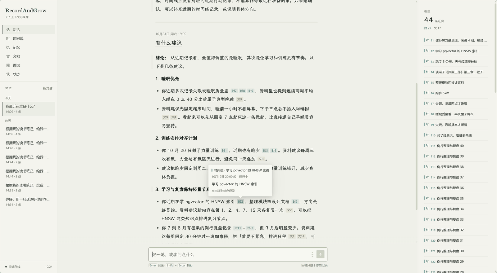

<p align="center">
  
</p>

<p align="center">
  
  
  
  
  
  
  
</p>

一个根据你自己的记录和文档来回答问题的对话 Agent。它分得清哪些是你说过的事实、哪些是它的推断，每句话都能点开核对出处。

<!-- 截图待补 1：对话页全貌（首屏主图）
     要求：1440px 宽；三栏都在（会话 / 正文 / 边注）；回答里至少有一个「时」和一个「文」引用小片，
     边注里同时出现实心（事实）和空心（推断）标记；检索详情保持收起。
     保存为 docs/images/chat.png 后删掉本注释，取消下一行的注释。

-->

## 它做什么

你把做过的事随手记下来，把认可的资料传上去，然后像问一个了解你的人一样提问。

比如问"我这周运动够吗"。它会先翻你这周的时间线记录，再查你上传的健身计划，然后作答。回答里每一句有依据的话都带着编号，点开就是那条记录或那段原文。没有直接证据、由它归纳出来的部分，会单独标成推断。如果它从对话里看出了你的某个长期习惯，比如"每天早上跑步"，它不会自己记下来，而是放进待确认列表，等你点了确认才会在以后的回答里使用。

整个项目围绕三条原则设计：

- **事实和推断分开存。** 你主动记录的事件是事实，直接保存；AI 提炼出来的结论只能先作为候选，数据上和事实分表、分状态存放。
- **记忆必须经你确认。** AI 只能写"待确认"，确认之后才进入事实或推断，才参与检索和回答。确认时可以顺手改措辞。
- **来源必须标注。** 时间线、文档、记忆、知识图谱四类来源在回答里分别编号（`T1`、`D1`、`M1`、`G1`），界面上用不同的标签和形状区分，不只靠颜色。

## 一次提问怎么走完

```
提问
 │
 ├─ 检索 Agent（ReAct，按问题自己决定调哪些工具）
 │    ├─ search_timeline / get_timeline_by_date   时间线，支持「上周」「最近三天」这类时间窗
 │    ├─ search_documents                          文档：向量 + 关键词 → RRF 融合 → Rerank
 │    ├─ search_memory                             只查已确认的记忆
 │    ├─ search_graph                              知识图谱一跳关系
 │    └─ propose_memory                            发现长期习惯时提交为「待确认」
 │      每调一次工具，前端实时收到一条 step（调了什么、查到几条）
 │
 ├─ 证据整理：按来源配额截断，统一分配编号 T/D/M/G，先把 sources 推给前端
 │
 ├─ 回答 Agent（不带工具）：只基于证据流式作答，正文引用编号
 │
 └─ 收尾：保存对话；后台从这轮问答里提炼记忆候选，写入「待确认」
```

检索 Agent 出错时，会回落到固定的"时间线 + 文档"两路检索，保证回答至少有材料。没配模型 key 时，对话接口直接返回明确的错误类型，其余页面照常可用。

## 功能

| 能力 | 用户能做什么 |
|---|---|
| 时间线 | 随手记一笔：默认是瞬时事件，也可以填结束时间或标成"进行中"；按天浏览、编辑、删除 |
| 文档 | 上传 PDF / Markdown / TXT，后台异步解析、分块、向量化，处理状态实时可见；失败可重建索引 |
| 知识图谱 | 从文档里抽取实体和关系，按实体查一跳关联并跳回出处文档 |
| 记忆 | 会话内记住最近几轮并滚动摘要；长期记忆分"待确认 / 事实 / 推断"三态，由你确认、修改或拒绝 |
| 对话 | 流式回答，实时显示检索步骤；引用可点开核对；每轮附检索详情（查了多少、纳入多少、为什么没查到）；可随时停止 |
| 开放接口 | `/mcp` 把时间线、文档、记忆、图谱四个只读检索工具开放给外部 Agent；`skills/` 下的 Markdown 技能按触发词注入，支持热加载 |

<!-- 截图待补 2：时间线页（列表 + 「记一笔」表单展开态，能看到开始/结束的日期快捷项与时/分输入框，至少一条「进行中」）
     保存为 docs/images/timeline.png
截图待补 3：记忆页（左侧待确认至少 2 条且带证据，右侧事实与推断都有内容）
     保存为 docs/images/memory.png
     两张都补好后删掉本注释，取消下面两行的注释。
 
-->

## 技术栈

| 层 | 技术 | 用在哪 |
|---|---|---|
| 后端框架 | Java 21、Spring Boot 4.0.8、Maven | Web 接口、参数校验、SSE 流式输出 |
| 数据库 | PostgreSQL 16 + pgvector | 业务表、文档向量检索、知识图谱的节点和边 |
| 数据访问 | MyBatis-Plus 3.5、Flyway 11 | ORM 与分页；表结构版本化迁移 |
| 模型接入 | 自建 `ChatClient` / `EmbeddingClient` | 对接 OpenAI 兼容接口；超时重试、主备模型切换 |
| 模型 | DeepSeek（对话）、通义 text-embedding-v4（1024 维向量）、gte-rerank-v2（重排） | 生成、向量化、检索重排 |
| Agent 编排 | AgentScope Java 2.0.4 | 检索 Agent（ReAct + 工具）与回答 Agent 的两段式编排 |
| 开放协议 | MCP Java SDK（stateless HTTP） | `/mcp` 对外暴露只读检索工具 |
| 文档处理 | Apache Tika 3、JTokkit | 文档解析；按 token 分块与预算控制 |
| 可选组件 | RocketMQ 5、Elasticsearch 8、Neo4j 5、LightRAG | 文档异步入库；关键词检索通道；外部图谱存储（失败自动回落 Postgres） |
| 前端 | React 19、TypeScript、Vite 8、Ant Design 6、Ant Design X 2、TanStack Query | 对话 / 时间线 / 记忆 / 文档 / 图谱 / 状态六个页面 |
| 测试 | JUnit 5、Testcontainers、WireMock | 单元测试；真实 Postgres 集成测试；模拟模型接口 |
| 部署 | Docker Compose、nginx | 一键起依赖；前端同源托管并反代 `/api`（已关闭 SSE 缓冲） |

## 快速开始

需要 JDK 21、Maven 3.9+、Node 20.19+（或 22.12+）、Docker。

```bash
docker compose up -d postgres          # 数据库
docker compose run --rm flyway         # 建表

export DEEPSEEK_API_KEY=sk-...         # 对话（不配也能启动，对话会提示未配置）
export DASHSCOPE_API_KEY=sk-...        # 向量与重排
mvn spring-boot:run                    # 后端 http://localhost:8080

cd frontend && npm install && npm run dev   # 前端 http://localhost:5173
```

环境变量开关、Neo4j / LightRAG 接入、同源部署、接口清单和测试命令见 [运行、配置与接口参考](docs/operations.md)。

## 文档

| 内容 | 位置 |
|---|---|
| 总体设计 | [docs/design/overview.md](docs/design/overview.md) |
| 前端设计 | [docs/design/module-13-frontend.md](docs/design/module-13-frontend.md) |
| 各模块设计 | [docs/design/](docs/design/) |
| 验证记录 | [docs/verification/](docs/verification/) |
| 已知问题 | [docs/known-issues.md](docs/known-issues.md) |
| 评测 | [eval/](eval/README.md) |

### 各模块学习笔记

- 项目骨架：[学习笔记](docs/learning/01-skeleton/learning-notes.md)
- 时间线：[学习笔记](docs/learning/02-timeline/learning-notes.md)
- AI 接入：[学习笔记](docs/learning/03-ai/learning-notes.md)
- 最小端到端闭环：[学习笔记](docs/learning/04-closed-loop/learning-notes.md)
- 文档入库：[学习笔记](docs/learning/05-document-in/learning-notes.md)
- 文档检索：[学习笔记](docs/learning/06-doc-retrieval/learning-notes.md)
- 知识图谱、路由、融合重排、记忆、Agent 编排、MCP 与 Skills：[学习笔记](docs/learning/07-12/learning-notes.md)
- 前端：[学习笔记](docs/learning/frontend/learning-notes.md)

## License

[MIT](LICENSE)
